<picture>
  <source media="(prefers-color-scheme: dark)" srcset="hero.svg">
  <source media="(prefers-color-scheme: light)" srcset="hero-light.svg">
  
</picture>



### Labs in numbers



### Detection pipeline



<a href="https://github.com/Rayan-Aldossary/Home-DataCenter">
  
</a>

### Tools I work with

<p>
  
  
  
  
  
  
  
  
  
  
  
  
  
</p>

<details>
<summary><code>RAYAN-01# show running-config</code></summary>

```text
hostname Rayan-Aldossary
!
service password-encryption
no ip http server
ip ssh version 2
login block-for 120 attempts 3 within 60
!
logging trap informational
logging host wazuh.swagger.lab
!
snmp-server location Saudi Arabia
snmp-server contact linkedin.com/in/rayanaldossary
!
vlan 10
 name networking
vlan 20
 name infrastructure
vlan 30
 name cybersecurity
!
interface Port-channel1
 description Home-DataCenter, 2x10G LACP
!
banner motd ^
 Authorized access only.
 Built, broken, fixed, documented.
^
!
end
```

</details>

<br>

<p align="center">
  <a href="https://sa.linkedin.com/in/rayanaldossary"></a>
</p>
